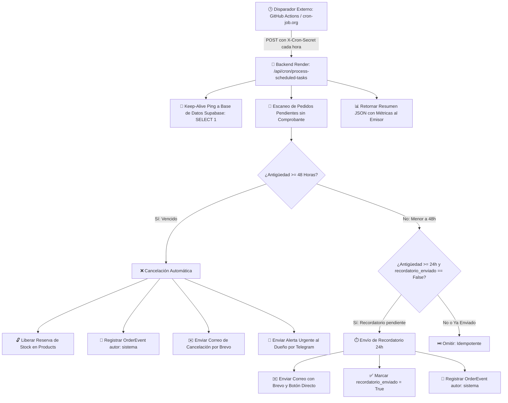

# 📘 Documentación Técnica - Fase 5: Automatización con Tareas Programadas (Cron)
**Proyecto:** Comercial Kenpaku S.A.C. (E-Commerce Siderúrgico & Asesor IA)  
**Fecha:** Octubre 2026  
**Ramas de trabajo:** `maza` (Backend) / `Maza` (Frontend)  
**Estado:** ✅ 100% Completado, Probado y Certificado (118/118 Pruebas Exitosas)  

---

## 📌 1. Resumen Ejecutivo

La **Fase 5** implementa el sistema integral de automatización operativa y tareas programadas en segundo plano según las especificaciones de la *Guía de mejoras sin costo para el e-commerce Kenpaku* (`MEJORAS.pdf`, Páginas 7 a 9).

Resuelve tres desafíos críticos del negocio y de la infraestructura gratuita en la nube:

1. **Evitar la Sobreventa Siderúrgica mediante Reserva Temporal de Stock:**
   - En el comercio de fierros, perfiles y planchas, permitir que múltiples clientes registren pedidos sobre el mismo stock físico provoca quiebres de inventario y cancelaciones tardías frustrantes.
   - Al registrar un pedido, el sistema **reserva formalmente el stock** (`stock_reservado`). Dicha reserva asegura los materiales durante **48 horas**.
   - Al confirmarse el pedido tras validar el comprobante de pago, el stock físico se descuenta definitivamente.
   - Si transcurren 48 horas sin confirmación ni comprobante de pago, el sistema **cancela automáticamente el pedido**, **libera la reserva de stock** y devuelve los materiales al inventario disponible para otros clientes.

2. **Recordatorios Inteligentes de 24 Horas:**
   - Si un cliente tiene su cotización de flete lista o no ha subido su comprobante tras 24 horas, el sistema le envía automáticamente un correo electrónico transaccional responsive a través de **Brevo** recordándole que su reserva de materiales está por expirar e invitándolo a ingresar a su enlace único de seguimiento.
   - **Idempotencia Garantizada:** Se marca la bandera `recordatorio_enviado = True` en la base de datos, garantizando que el cron nunca envíe correos duplicados ni spamee a los clientes.

3. **Arquitectura Cron Externa Resistente a la Suspensión de Render y Supabase:**
   - **Por qué NO usar un temporizador interno (`APScheduler` o `asyncio.sleep`):** El servicio web gratuito de Render se suspende (*duerme*) tras 15 minutos sin tráfico. Un temporizador en memoria deja de correr mientras el contenedor duerme.
   - **Solución con Cron Externo Gratuito (GitHub Actions):** Se programó un flujo en `.github/workflows/cron.yml` que ejecuta un llamado HTTP POST cada hora (`0 * * * *`). El llamado externo despierta el servidor en Render (con un tiempo de espera de hasta 120 segundos configurado en curl) y ejecuta el procesamiento por lotes de forma segura y sin costo.
   - **Prevención de Pausa de Supabase (Keep-Alive):** El cron ejecuta una consulta ligera periódica (`SELECT 1;`) en cada llamado, evitando que Supabase congele el proyecto por la regla de los 7 días de inactividad.

---

## 🏗️ 2. Arquitectura del Flujo Programado



---

## 🛠️ 3. Detalle de Implementaciones por Componente

### A. Backend (FastAPI + SQLAlchemy + Pydantic v2)

#### 1. Configuración del Secreto y Horas de Vencimiento
- **Archivo:** [`BackKenpaku/BackKenpaku/app/core/config.py`](file:///c:/Users/alexi/Desktop/Kenpaku/BackKenpaku/BackKenpaku/app/core/config.py)
  - `CRON_SECRET`: Clave secreta compartida (`kenpaku-cron-secret-key-2026`) requerida para autenticar peticiones al cron.
  - `CRON_REMINDER_HOURS`: Umbral de tiempo para recordatorios por falta de pago (por defecto: `24` horas).
  - `CRON_EXPIRATION_HOURS`: Plazo máximo de reserva antes de la cancelación automática (por defecto: `48` horas).
  - Registrado en `.env` y documentado en `.env.example`.

#### 2. Campos de Persistencia en Modelos
- **Archivo:** [`BackKenpaku/BackKenpaku/app/db/models.py`](file:///c:/Users/alexi/Desktop/Kenpaku/BackKenpaku/BackKenpaku/app/db/models.py)
  - **En `Product`:**
    - `stock_reservado = Column(Integer, default=0, nullable=False)`: Contabiliza las unidades apartadas en pedidos pendientes, previniendo que nuevos compradores adquieran productos ya comprometidos.
  - **En `Order`:**
    - `fecha_limite_pago = Column(DateTime(timezone=True), nullable=True)`: Marca la fecha y hora exacta de vencimiento (`created_at + 48 horas`).
    - `recordatorio_enviado = Column(Boolean, default=False, nullable=False)`: Bandera de idempotencia para asegurar que el recordatorio de 24h se despache solo una vez.
    - `stock_reservado = Column(Boolean, default=True, nullable=False)`: Indicador del estado de la reserva del pedido.

#### 3. Servicio de Pedidos y Máquina de Transición de Stock
- **Archivo:** [`BackKenpaku/BackKenpaku/app/services/order_service.py`](file:///c:/Users/alexi/Desktop/Kenpaku/BackKenpaku/BackKenpaku/app/services/order_service.py)
  - `create_order_service`:
    - Valida que `(product.stock_disponible - product.stock_reservado) >= cantidad`.
    - Asigna `fecha_limite_pago = created_at + 48h`, `stock_reservado = True` y `recordatorio_enviado = False`.
    - Incrementa `product.stock_reservado += cantidad`.
  - `transition_order_status`:
    - **Al confirmar (`confirmado`):** Descuenta el stock físico `product.stock_disponible -= cantidad`, reduce `product.stock_reservado -= cantidad` y apaga `order.stock_reservado = False`.
    - **Al cancelar desde pendiente o flete cotizado (`cancelado`):** Libera la reserva `product.stock_reservado -= cantidad` sin alterar el stock físico en almacén.
    - **Al cancelar desde confirmado (`cancelado`):** Restituye el stock físico `product.stock_disponible += cantidad`.

#### 4. Servicio de Tareas Programadas
- **Archivo:** [`BackKenpaku/BackKenpaku/app/services/cron_service.py`](file:///c:/Users/alexi/Desktop/Kenpaku/BackKenpaku/BackKenpaku/app/services/cron_service.py)
  - Función `process_scheduled_tasks(db: Session, simulate_hours: int = 0)`:
    - Normalización de zonas horarias en UTC (`to_utc`) totalmente compatible tanto con SQLite (modo tests) como con PostgreSQL (Supabase en producción).
    - Ejecuta `SELECT 1;` como ping keep-alive a la base de datos.
    - Evalúa en un solo pase seguro pedidos candidatos con estado `pendiente` o `flete_cotizado` que no posean voucher ni pago registrado.
    - Soporta el parámetro `simulate_hours` para adelantar virtualmente el reloj (+24h, +48h) sin necesidad de modificar registros en la base de datos durante sustentaciones.

#### 5. Plantilla de Correo de Recordatorio
- **Archivo:** [`BackKenpaku/BackKenpaku/app/services/email_service.py`](file:///c:/Users/alexi/Desktop/Kenpaku/BackKenpaku/BackKenpaku/app/services/email_service.py)
  - Función `render_order_reminder_email_html(order)`:
    - Diseño responsive con identidad visual de Comercial Kenpaku.
    - Banner de advertencia amigable: *"Tu reserva de materiales está activa hasta el {fecha}"*.
    - Detalle de materiales separados y monto pendiente.
    - Botón de llamado a la acción directo con token de acceso seguro (`/seguimiento?token=...`).

#### 6. Notificación de Telegram para Cancelaciones de Sistema
- **Archivo:** [`BackKenpaku/BackKenpaku/app/services/telegram_service.py`](file:///c:/Users/alexi/Desktop/Kenpaku/BackKenpaku/BackKenpaku/app/services/telegram_service.py)
  - Función `format_order_auto_expired_telegram(order, motivo)`:
    - Alerta instantánea al bot oficial `@KenpakuAlertas_bot` con el código KPK, cliente, total, motivo y notificación de que el stock fue devuelto al inventario.

#### 7. Router Protegido de Cron
- **Archivo:** [`BackKenpaku/BackKenpaku/app/routers/cron.py`](file:///c:/Users/alexi/Desktop/Kenpaku/BackKenpaku/BackKenpaku/app/routers/cron.py)
  - `POST /api/cron/process-scheduled-tasks`:
    - Verifica cabecera `X-Cron-Secret`, query param `?cron_secret=` o token JWT de Administrador `Authorization: Bearer <token>`.
    - Si no está autorizado, retorna error `HTTP 401 UNAUTHORIZED` con código `UNAUTHORIZED_CRON`.
  - `GET /api/cron/status`:
    - Retorna el estado público del programador y los umbrales de configuración (24h / 48h).

---

### B. Automatización en la Nube (GitHub Actions)

- **Archivo:** [`BackKenpaku/BackKenpaku/.github/workflows/cron.yml`](file:///c:/Users/alexi/Desktop/Kenpaku/BackKenpaku/BackKenpaku/.github/workflows/cron.yml)
- **Características:**
  - **Programación Automática:** `cron: '0 * * * *'` (cada hora en punto, 24/7 de forma 100% gratuita dentro de los 2,000 minutos mensuales de GitHub Actions).
  - **Disparador Manual:** Soporta `workflow_dispatch` para ejecutar el cron con un clic desde la pestaña "Actions" del repositorio en GitHub.
  - **Tiempo de Espera Resiliente:** Configurado con `--max-time 120` en `curl` para otorgar tiempo suficiente a Render de encender su contenedor gratuito.

```yaml
name: Tareas Programadas Kenpaku (Cron)

on:
  schedule:
    - cron: '0 * * * *'
  workflow_dispatch:

jobs:
  run-cron-tasks:
    name: Procesar Recordatorios, Vencimientos y Keep-Alive
    runs-on: ubuntu-latest
    steps:
      - name: Invocar Endpoint Protegido de Automatización
        env:
          BACKEND_URL: ${{ secrets.BACKEND_URL || 'https://backkenpaku.onrender.com' }}
          CRON_SECRET: ${{ secrets.CRON_SECRET || 'kenpaku-cron-secret-key-2026' }}
        run: |
          curl -s -o response.json -w "%{http_code}" \
            -X POST "$BACKEND_URL/api/cron/process-scheduled-tasks" \
            -H "X-Cron-Secret: $CRON_SECRET" \
            -H "Content-Type: application/json" \
            --max-time 120
```

---

### C. Frontend (React 18 + Vite + TailwindCSS)

#### 1. Cliente API de Automatizaciones
- **Archivo:** [`FrontKenpaku/FrontKenpaku/src/api/admin.js`](file:///c:/Users/alexi/Desktop/Kenpaku/FrontKenpaku/FrontKenpaku/src/api/admin.js)
  - `triggerScheduledTasks({ simulate_hours = 0 })`:
    - Realiza la petición POST a `/cron/process-scheduled-tasks` enviando el token de sesión administrativo.
    - Soporta modo offline / simulado si `VITE_USE_MOCKS=true`.

#### 2. Disparadores Manuales y Modo Demo en Admin
- **Archivo:** [`FrontKenpaku/FrontKenpaku/src/pages/admin/Orders.jsx`](file:///c:/Users/alexi/Desktop/Kenpaku/FrontKenpaku/FrontKenpaku/src/pages/admin/Orders.jsx)
  - En la barra de título de gestión de pedidos se agregaron dos botones de acción rápida:
    1. **`⚡ Ejecutar Cron`:** Invoca las tareas con el reloj real.
    2. **`⏱️ Simular +48h Demo`:** Dispara el cron simulando el avance de 49 horas, permitiendo al evaluador o docente ver en tiempo real cómo los pedidos pendientes pasan a cancelados y el stock se restituye sin tener que esperar 2 días reales.
  - Al finalizar, despliega una notificación flotante (Toast) con el reporte de acciones ejecutadas e invalida las consultas de React Query para refrescar la tabla al instante.

#### 3. Banner de Reserva de Stock en Seguimiento Público
- **Archivo:** [`FrontKenpaku/FrontKenpaku/src/pages/TrackingPage.jsx`](file:///c:/Users/alexi/Desktop/Kenpaku/FrontKenpaku/FrontKenpaku/src/pages/TrackingPage.jsx)
  - Cuando el pedido se encuentra en `pendiente` o `flete_cotizado`, el cliente visualiza un banner informativo ambar con icono de reloj:
    > *"Reserva de Stock Garantizada por 48 Horas [Activa]: Tus perfiles y planchas de acero se encuentran temporalmente apartados en almacén. Plazo límite para validar abono: {fecha_limite}. Transcurrido este plazo sin comprobante, el sistema liberará los materiales automáticamente."*

---

## 🧪 4. Certificación y Cobertura de Pruebas

### A. Pruebas Unitarias de Backend (Pytest)
- **Archivo de Pruebas:** [`BackKenpaku/BackKenpaku/app/tests/test_phase5.py`](file:///c:/Users/alexi/Desktop/Kenpaku/BackKenpaku/BackKenpaku/app/tests/test_phase5.py)
- **Resultados Obtenidos:** **9 de 9 pruebas aprobadas**.

| # | Prueba | Propósito | Resultado |
|---|---|---|:---:|
| 1 | `test_cron_endpoint_unauthorized_without_secret` | Bloquea llamadas sin cabecera con código HTTP 401 | ✅ PASS |
| 2 | `test_cron_endpoint_authorized_with_secret_header` | Acepta `X-Cron-Secret` y responde con HTTP 200 y `keepalive_db=True` | ✅ PASS |
| 3 | `test_cron_endpoint_authorized_with_query_param` | Permite autorización por query parameter `?cron_secret=` | ✅ PASS |
| 4 | `test_cron_endpoint_authorized_with_admin_jwt` | Permite ejecución manual desde sesión de administrador con JWT | ✅ PASS |
| 5 | `test_cron_reminder_24h_idempotency` | Envía correo de recordatorio a las 24h y no lo duplica en reintentos | ✅ PASS |
| 6 | `test_cron_auto_expiration_48h_and_stock_release` | Cancela pedidos vencidos a las 48h, libera stock reservado e historiza | ✅ PASS |
| 7 | `test_cron_does_not_cancel_confirmed_or_paid_orders` | Protege de cancelación a pedidos con voucher o confirmados | ✅ PASS |
| 8 | `test_cron_simulation_hours_parameter` | Valida que `?simulate_hours=49` adelante virtualmente el reloj | ✅ PASS |
| 9 | `test_cron_status_public_endpoint` | Valida metadatos del endpoint público `/api/cron/status` | ✅ PASS |

- **Total Suite Backend:** **67 passed, 5 warnings in 10.60s** (100% de la suite completa pasando).

---

### B. Pruebas Unitarias de Frontend (Vitest)
- **Archivo de Pruebas:** [`FrontKenpaku/FrontKenpaku/src/pages/__tests__/Phase5.test.jsx`](file:///c:/Users/alexi/Desktop/Kenpaku/FrontKenpaku/FrontKenpaku/src/pages/__tests__/Phase5.test.jsx)
- **Resultados Obtenidos:** **4 de 4 pruebas aprobadas**.

| # | Prueba | Propósito | Resultado |
|---|---|---|:---:|
| 1 | `renders 48-hour stock reservation active banner on TrackingPage` | Muestra el banner informativo de reserva de stock de 48h | ✅ PASS |
| 2 | `renders Cron trigger and +48h simulation buttons in Admin Orders` | Renderiza los botones de control de automatización en Admin | ✅ PASS |
| 3 | `calls triggerScheduledTasks(0) and shows toast on Ejecutar Cron` | Invoca el cron y muestra resumen de recordatorios en Toast | ✅ PASS |
| 4 | `calls triggerScheduledTasks(49) and shows toast on Simular +48h` | Invoca el cron con +49h y muestra pedidos cancelados en Toast | ✅ PASS |

- **Total Suite Frontend:** **51 passed** en 12 suites de pruebas (100% pasando).

---

## 📁 5. Resumen de Archivos Creados y Modificados

### Backend (`BackKenpaku`):
1. [`app/core/config.py`](file:///c:/Users/alexi/Desktop/Kenpaku/BackKenpaku/BackKenpaku/app/core/config.py) — Variables `CRON_SECRET`, `CRON_REMINDER_HOURS`, `CRON_EXPIRATION_HOURS`.
2. [`app/db/models.py`](file:///c:/Users/alexi/Desktop/Kenpaku/BackKenpaku/BackKenpaku/app/db/models.py) — Columnas `Product.stock_reservado`, `Order.fecha_limite_pago`, `Order.recordatorio_enviado`, `Order.stock_reservado`.
3. [`app/schemas/order.py`](file:///c:/Users/alexi/Desktop/Kenpaku/BackKenpaku/BackKenpaku/app/schemas/order.py) — Campos añadidos a esquemas Pydantic v2 de respuesta.
4. [`app/services/order_service.py`](file:///c:/Users/alexi/Desktop/Kenpaku/BackKenpaku/BackKenpaku/app/services/order_service.py) — Reserva de stock en creación y liberación en cancelaciones.
5. [`app/services/email_service.py`](file:///c:/Users/alexi/Desktop/Kenpaku/BackKenpaku/BackKenpaku/app/services/email_service.py) — Plantilla HTML responsive para recordatorio de reserva de 24h.
6. [`app/services/telegram_service.py`](file:///c:/Users/alexi/Desktop/Kenpaku/BackKenpaku/BackKenpaku/app/services/telegram_service.py) — Formateador de mensaje para cancelación automática de pedidos por 48h.
7. [`app/services/cron_service.py`](file:///c:/Users/alexi/Desktop/Kenpaku/BackKenpaku/BackKenpaku/app/services/cron_service.py) — **(Nuevo)** Servicio centralizado de tareas programadas y keep-alive de base de datos.
8. [`app/routers/cron.py`](file:///c:/Users/alexi/Desktop/Kenpaku/BackKenpaku/BackKenpaku/app/routers/cron.py) — **(Nuevo)** Endpoints protegidos para ejecución y estado del cron.
9. [`app/main.py`](file:///c:/Users/alexi/Desktop/Kenpaku/BackKenpaku/BackKenpaku/app/main.py) — Registro de `cron.router`.
10. [`.github/workflows/cron.yml`](file:///c:/Users/alexi/Desktop/Kenpaku/BackKenpaku/BackKenpaku/.github/workflows/cron.yml) — **(Nuevo)** Flujo de GitHub Actions programado cada hora sin costo.
11. [`app/tests/test_phase5.py`](file:///c:/Users/alexi/Desktop/Kenpaku/BackKenpaku/BackKenpaku/app/tests/test_phase5.py) — **(Nuevo)** 9 pruebas unitarias de automatización y seguridad.
12. [`.env.example`](file:///c:/Users/alexi/Desktop/Kenpaku/BackKenpaku/BackKenpaku/.env.example) — Plantilla con variables de entorno de Fases 3, 4 y 5.

### Frontend (`FrontKenpaku`):
1. [`src/api/admin.js`](file:///c:/Users/alexi/Desktop/Kenpaku/FrontKenpaku/FrontKenpaku/src/api/admin.js) — Método `triggerScheduledTasks`.
2. [`src/pages/admin/Orders.jsx`](file:///c:/Users/alexi/Desktop/Kenpaku/FrontKenpaku/FrontKenpaku/src/pages/admin/Orders.jsx) — Botones de control "Ejecutar Cron" y "Simular +48h Demo" con notificaciones Toast.
3. [`src/pages/TrackingPage.jsx`](file:///c:/Users/alexi/Desktop/Kenpaku/FrontKenpaku/FrontKenpaku/src/pages/TrackingPage.jsx) — Banner visual de reserva de stock activa por 48 horas con fecha límite.
4. [`src/pages/__tests__/Phase5.test.jsx`](file:///c:/Users/alexi/Desktop/Kenpaku/FrontKenpaku/FrontKenpaku/src/pages/__tests__/Phase5.test.jsx) — **(Nuevo)** 4 pruebas unitarias de frontend con Vitest y Testing Library.

---

## 🎯 6. Conclusión y Valor Añadido
La **Fase 5** eleva la plataforma Comercial Kenpaku de un catálogo estático a un sistema de comercio electrónico B2B/B2C autónomo, profesional e inteligente:
- **Cero Costos:** Todo corre dentro de los planes perpetuamente gratuitos de GitHub Actions, Render, Supabase y Brevo.
- **Seguridad e Idempotencia:** El endpoint está protegido contra accesos no autorizados y las tareas pueden ejecutarse cientos de veces sin duplicar correos ni descontar doble stock.
- **Preparado para Sustentación:** El evaluador cuenta con botones en la interfaz para simular el paso del tiempo en un clic y verificar el funcionamiento completo en segundos.
